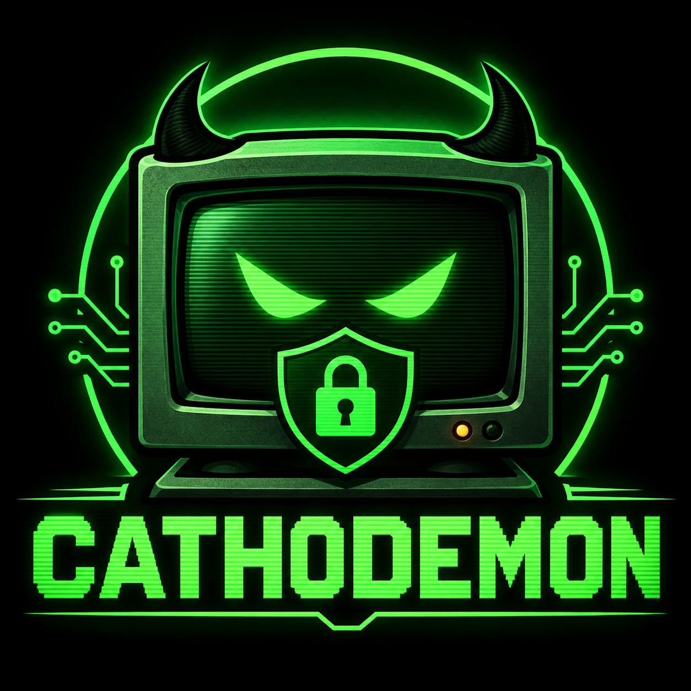

<p align="center">
  
</p>

# CATHODEMON

> A retro-terminal home security suite. **Old tech, modern problems.**

The name: *cathode*, from the cathode-ray tube behind every old terminal screen,
plus *demon* for Halloween. It's also a pun on *daemon*, the Unix word for a
program that runs quietly in the background, which is what DNS Shield does.

A native Python desktop app that revives a handful of old-school security ideas
(PGP-style signing and encryption, `finger`/`whois`-style lookups, random-word
passphrases, a DNS sinkhole, log forensics) behind a green-on-black CRT interface.

**Everything is written in this repository on top of the Python standard
library.** There are no third-party packages, downloaded blocklists, lookup
services or Docker images. The cipher, the public-key crypto, the DNS resolver,
the DNS server, the X.509 parser, the strength estimator and the blocklists are
all ours.

```
 ████  ███  █████ █   █  ███  ████  █████ █   █  ███  █   █
█     █   █   █   █   █ █   █ █   █ █     ██ ██ █   █ ██  █
█     █████   █   █████ █   █ █   █ ████  █ █ █ █   █ █ █ █
█     █   █   █   █   █ █   █ █   █ █     █   █ █   █ █  ██
 ████ █   █   █   █   █  ███  ████  █████ █   █  ███  █   █
```

## Run it

Requires **Python 3.11+** with Tkinter (included in the python.org installers for
Windows and macOS; on Linux install `python3-tk`).

On Windows, `cdm` is the short command. Run it from the project folder; in
PowerShell, type `.\cdm` instead of `cdm`.

| Command | What it does |
|---|---|
| `cdm` | Open the app |
| `cdm shield` | Run DNS Shield without the window (`cdm shield --help` lists the options) |
| `cdm test` | Run the import audit and every test suite |
| `cdm test core` | Run one suite: `audit`, `crypto`, `dns`, `core`, `properties` or `gui` |
| `cdm audit` | Check that every import is the standard library or our own code |
| `cdm help` | List these commands |

On macOS and Linux, run `python -m cathodemon` from the project folder in place
of `cdm`, for example `python -m cathodemon shield`.

There is nothing to install. If `python -c "import tkinter"` works, Cathodemon runs.

The `properties` suite runs property-based tests: each rule is checked against
many random inputs and any failure is shrunk to the simplest case. Set
`CATHODEMON_PBT_RUNS` for more inputs (1000 before submitting) or
`CATHODEMON_PBT_SEED=<n>` to reproduce a specific run.

## The tools

| Tool | What it does | Built on |
|---|---|---|
| **Mail** | Generate keys, sign and encrypt messages, decrypt and verify, plus an explainable phishing analyzer | our `rsa`, `chacha`, `securemsg`; `hashlib.scrypt` |
| **Recon** | Domain/URL reputation report: certificate age, DNS oddities, typosquat, homoglyph and IDN look-alikes | our `resolver`, `x509der`, `lookalike`; `ssl` |
| **Vault** | Password strength, offline leak check, passphrase generator, habits audit | our `passwords`, `leaks`; `secrets` |
| **Chronicle** | Raw auth, web and firewall logs turned into a correlated incident timeline and narrative | our `logstory` |
| **DNS Shield** | A DNS server for the whole home network that blocks ads, trackers and look-alike phishing domains | our `sinkhole`, `resolver`, `blocklist`; `socketserver` |

## DNS Shield

DNS Shield is Cathodemon's own DNS server. Each device on your network asks it to
look up names. It answers in one of three ways:

- **Blocked** names (ads, trackers, telemetry, browser crypto-miners, IP loggers,
  and look-alike phishing domains) get `0.0.0.0`, so nothing loads.
- **Local** names (`printer`, `*.lan`, reverse lookups of private addresses) are
  answered on the spot and never sent to the internet.
- **Everything else** is looked up by Cathodemon's own resolver. It asks a DNS root
  server, then the top-level-domain servers, then the domain's own servers. No
  third-party DNS service (Cloudflare, Google, your ISP) sees your lookups.

The built-in list (`cathodemon/data/blocklist.txt`) only lists domains whose job is
ads, tracking or telemetry, so normal sites keep working. Phishing look-alikes are
caught by rules rather than a list, because new ones appear every day. For
Ebonmarsh, the made-up bank in Cathodemon's samples, that means `ebonm4rsh.example`
(swapped characters), `ebonmarsh-secure-login.example` (brand name plus a login
word) and Unicode copies of the name. You can add your
own block and allow entries in the app. The allow list wins over every block.

To protect the whole network:

1. Run DNS Shield on a computer that stays on (desktop, home server, Raspberry Pi):
   `cdm shield`, or `python -m cathodemon shield` on macOS and Linux.
2. In your router's settings, set the DNS server it hands out (DHCP) to that
   computer's address.
3. From another device, `nslookup ebonm4rsh.example <that address>` should answer
   `0.0.0.0`. Its lookups also appear under Activity in the DNS Shield screen.

It answers only devices on your local network by default, so it can't be abused
as an open resolver. Port 53 is the standard DNS port: Windows may ask you to let
Python through the firewall, and on Linux it needs root, and `systemd-resolved` may
already be using the port. Cathodemon does not check DNSSEC signatures.

## A note on the cryptography (please read)

The Mail tool needs signing and encryption, and the standard library has neither
public-key crypto nor a modern cipher. So Cathodemon implements its own:

- **ChaCha20-Poly1305** (RFC 8439), checked byte-for-byte against the RFC's
  published test vectors (ciphertext **and** tag).
- **RSA**: key generation (Miller-Rabin), OAEP encryption and PKCS#1 v1.5
  signatures (RFC 8017), tested for round-trips and for rejecting tampering and forgery.
- Private keys are protected with **scrypt** (`hashlib.scrypt`) plus ChaCha20-Poly1305.

This is an **educational, self-contained** scheme with its own "CATHODEMON MESSAGE"
format. It is not OpenPGP. Hand-written crypto, even when it matches the test
vectors, should **not** guard life-or-safety secrets. Use audited tools such as
GnuPG or `age` for that.

## Privacy model

- **Never leaves your device:** private keys, the passwords you test (the leak
  check is offline), generated passphrases, and all log data.
- **Recon** looks up only the domain you type. It asks the DNS hierarchy and the
  domain's own servers, and it connects to the site itself to read its certificate.
- **DNS Shield** sends allowed lookups to the DNS hierarchy, the same way any
  DNS server must. Blocked and local names never leave the network.
- Nothing is uploaded or logged to disk. The keyring lives at
  `~/.cathodemon/keyring.json` with private keys encrypted under your passphrase.

## What still comes from outside

| Piece | Why it can't be removed |
|---|---|
| Python and its standard library (including Tcl/Tk behind Tkinter and OpenSSL behind `ssl`) | It's the language the app is written in |
| Your operating system's list of trusted certificate authorities | Recon uses it to say whether a site's certificate chain is valid |
| The DNS hierarchy (root, top-level-domain and each domain's own servers) | Any DNS lookup has to ask the servers that hold the records |
| The website you scan in Recon | Its certificate can only come from the site itself |

## Project layout

```
cathodemon/
  __main__.py  app.py  theme.py  widgets.py  workers.py   # Tkinter shell
  shield.py                                               # DNS Shield without the window
  data/blocklist.txt                                      # our blocklist
  core/
    rsa.py  chacha.py  securemsg.py                       # cryptography
    dnswire.py  resolver.py  dnsclient.py                 # DNS packets and our resolver
    sinkhole.py  blocklist.py                             # DNS Shield server and rules
    x509der.py  cert.py  dns_checks.py  lookalike.py  reputation.py   # Recon
    passwords.py  leaks.py  phishing.py  logstory.py
  ui/                                                     # one Tkinter view per tool
examples/      # sample phishing email + sample incident log
scripts/       # tests and the import audit
```

## Tests

```bash
cdm test           # the import audit and all four test suites
cdm test dns       # one suite: audit, crypto, dns, core or gui
```

| Suite | What it checks |
|---|---|
| `audit` | Every import is the standard library or our own code |
| `crypto` | The cipher and RSA, against the RFC 8439 test vectors |
| `dns` | DNS packets, our resolver and the DNS Shield server (uses the network) |
| `core` | Recon, secure messages, passwords and the leak check (uses the network) |
| `gui` | Opens the window and drives every screen |

`cdm test` runs every suite with `python -S`, which hides all installed
packages, so a pass also shows that nothing outside the standard library is
needed. Each suite is a script in `scripts/` that you can also run on its own,
for example `python -S scripts/try_gui.py`.

## License

**MIT** (see `LICENSE`). Copyright (c) 2026 [AZ7cy](https://github.com/AZ7cy).

All code and data in this repository were written for Cathodemon and depend only on
the Python standard library.
